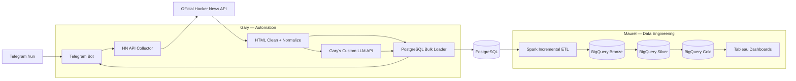

# PROJECT PLANNING 4

## AI Tech Trend & Sentiment Tracker

> **Hacker News → Gary's Custom LLM API → PostgreSQL → Apache Spark → Google BigQuery → Tableau**  
> Status: **Technical planning; belum ada kode program**  
> Target MVP: **4 minggu**

---

## 1. Project Title & Concept

### Judul

**AI Tech Trend & Sentiment Tracker**

### Konsep

Sistem mengambil diskusi teknologi terkini dari **Hacker News API**, menganalisis topik dan sentimen menggunakan **Gary's Custom LLM API**, lalu langsung menyimpan raw data, hasil AI, dan execution log ke PostgreSQL milik Maurel.

Apache Spark membaca PostgreSQL secara incremental, membersihkan dan mengagregasi data, kemudian memuatnya ke BigQuery dalam layer Bronze, Silver, dan Gold. Tableau membaca Gold tables untuk menampilkan tren teknologi, perubahan sentimen, engagement, dan kualitas pipeline.

### Scope decision

Instruksi stack terakhir menetapkan **tanpa social-media posting**. Karena itu:

- Telegram hanya digunakan sebagai trigger dan status notification.
- Tidak ada Threads API atau autopost.
- Automated action terakhir milik Gary adalah **direct data insertion ke PostgreSQL** dan mengirim ringkasan status run ke Telegram.

### Workflow satu baris

> **Telegram `/run` → Hacker News Top Stories → story/comment collection → Gary's Custom LLM API → PostgreSQL transaction → Telegram run summary → Spark JDBC → BigQuery Bronze/Silver/Gold → Tableau.**

### Output bisnis

Dashboard menjawab:

1. Teknologi/topik apa yang paling banyak dibahas?
2. Topik mana yang engagement-nya tumbuh paling cepat?
3. Bagaimana sentimen komunitas terhadap setiap topik?
4. Story apa yang menjadi evidence utama suatu tren?
5. Apakah hasil AI dan data pipeline lengkap, fresh, dan dapat dipercaya?

---

## 2. Explicit Bill of Materials

## 2.1 API dan akun

| Komponen | Nama/endpoint | Fungsi | Akun/credential |
|---|---|---|---|
| Trigger | **Telegram Bot API** — `https://api.telegram.org/bot<TOKEN>/<METHOD>` | Menangani `/run`, `/status`, `/latest` dan mengirim run summary | Akun Telegram, bot dari `@BotFather`, bot token, admin user/chat ID |
| Source | **Official Hacker News API v0** — `https://hacker-news.firebaseio.com/v0/` | Mengambil story dan comment publik | Tidak membutuhkan akun/API key |
| Story list | `GET /topstories.json` | Mengambil current top-story IDs | Tidak ada credential |
| Item detail | `GET /item/{item_id}.json` | Mengambil detail story atau comment | Tidak ada credential |
| AI processing | **Gary's Custom LLM API** — `POST https://<GARY_LLM_HOST>/v1/tech-trends/analyze` | Topic extraction, clustering, summary, dan sentiment analysis | Endpoint milik Gary dan `GARY_LLM_API_KEY` |
| Primary database | **PostgreSQL**; rekomendasi hosted development: Supabase Free | Shared operational database | PostgreSQL host, port, database, ingest user, password, SSL mode |
| Warehouse | **Google BigQuery** | Bronze, Silver, dan Gold analytical storage | Google Cloud project dan service account |
| Visualization | **Tableau Desktop/Public-compatible workflow** | Dashboard dari BigQuery Gold tables | Tableau account; Google OAuth atau service-account connection |

Official HN API menyediakan near-real-time public data dan mendokumentasikan `topstories` serta `item/{id}` di [Hacker News API repository](https://github.com/HackerNews/API). Dokumentasi saat diperiksa menyatakan tidak ada rate limit, tetapi aplikasi tetap harus menggunakan concurrency limit, timeout, cache, dan request cap.

## 2.2 Batas pengambilan data per run

Agar sederhana dan stabil:

- Ambil maksimum **30 top stories**.
- Ambil maksimum **20 top-level comments** per story.
- Jangan melakukan recursive traversal ke seluruh comment tree pada MVP.
- Abaikan item dengan `deleted=true` atau `dead=true` dari input LLM, tetapi simpan statusnya untuk audit.
- Maksimum teoritis: 1 request list + 30 story requests + 600 comment requests per run.
- Batasi concurrency HTTP, misalnya 10 concurrent requests.
- Cache item dalam satu run agar item ID yang sama tidak diminta dua kali.

## 2.3 Gary — libraries dan tools

| Library/tool | Fungsi |
|---|---|
| Python 3.11 | Runtime automation |
| `python-telegram-bot[job-queue]` | Telegram long polling, commands, dan optional scheduler |
| `httpx` | Async HTTP client untuk HN API dan Gary's Custom LLM API |
| `pydantic` | Validasi source model, request LLM, dan response LLM |
| `psycopg[binary]` | Direct insert/upsert ke PostgreSQL |
| `beautifulsoup4` | Mengubah comment HTML menjadi plain text sebelum AI processing |
| `tenacity` | Bounded retry dengan exponential backoff |
| `structlog` | Structured execution logs |
| `python-dotenv` | Local environment variables; `.env` tidak boleh masuk Git |

Tidak diperlukan: LangChain, CrewAI, Kafka, Redis, Celery, web frontend, atau social-media SDK.

## 2.4 Maurel — libraries dan tools

| Library/tool | Fungsi |
|---|---|
| PostgreSQL 16+ | Primary database dan integration boundary |
| Apache Spark/PySpark 3.5.x | Incremental ETL, data quality, dan aggregations |
| OpenJDK 17 | Spark runtime |
| PostgreSQL JDBC Driver — `org.postgresql:postgresql` | Spark membaca PostgreSQL |
| Spark BigQuery Connector — `com.google.cloud.spark:spark-3.5-bigquery` | Spark menulis BigQuery |
| `google-cloud-bigquery` | BigQuery metadata/setup checks jika dibutuhkan |
| Google BigQuery | Data warehouse |
| Tableau Desktop | Membuat dashboard melalui native BigQuery connector |

Google mendokumentasikan Spark-to-BigQuery melalui [Spark BigQuery Connector](https://github.com/GoogleCloudDataproc/spark-bigquery-connector). Tableau menyediakan [native Google BigQuery connector](https://help.tableau.com/current/pro/desktop/en-us/examples_googlebigquery.htm) dengan OAuth atau service-account authentication.

## 2.5 Environment variables

### Gary

| Variable | Isi |
|---|---|
| `TELEGRAM_BOT_TOKEN` | Secret dari BotFather |
| `TELEGRAM_ADMIN_CHAT_ID` | Chat tujuan status |
| `TELEGRAM_ALLOWED_USER_IDS` | User IDs yang boleh menjalankan bot |
| `HN_API_BASE_URL` | `https://hacker-news.firebaseio.com/v0` |
| `HN_STORY_LIMIT` | `30` |
| `HN_COMMENT_LIMIT_PER_STORY` | `20` |
| `CUSTOM_LLM_BASE_URL` | Host Custom LLM milik Gary |
| `CUSTOM_LLM_API_KEY` | Secret untuk Gary's Custom LLM API |
| `CUSTOM_LLM_ENDPOINT` | `/v1/tech-trends/analyze` |
| `CUSTOM_LLM_TIMEOUT_SECONDS` | Timeout request AI |
| `POSTGRES_DSN` | SSL PostgreSQL connection string untuk ingest user |
| `PROMPT_VERSION` | Misalnya `tech-trend-v1` |
| `PIPELINE_SCHEMA_VERSION` | Misalnya `1.0` |
| `LOG_LEVEL` | `INFO` |

### Maurel

| Variable | Isi |
|---|---|
| `POSTGRES_JDBC_URL` | SSL JDBC URL |
| `POSTGRES_SPARK_USER` | Read/checkpoint user |
| `POSTGRES_SPARK_PASSWORD` | Secret |
| `GCP_PROJECT_ID` | Google Cloud project |
| `BQ_BRONZE_DATASET` | `techtrend_bronze` |
| `BQ_SILVER_DATASET` | `techtrend_silver` |
| `BQ_GOLD_DATASET` | `techtrend_gold` |
| `BQ_LOCATION` | Satu region konsisten |
| `GOOGLE_APPLICATION_CREDENTIALS` | Path service-account JSON |
| `GCS_TEMP_BUCKET` | Temp bucket jika connector mode memerlukannya |
| `SPARK_JOB_NAME` | `techtrend_hourly` |

---

## 3. Gary's Custom LLM API Contract

Tidak ada external AI provider. Semua AI request dikirim ke endpoint milik Gary:

`POST https://<GARY_LLM_HOST>/v1/tech-trends/analyze`

### Request contract

| Field | Isi |
|---|---|
| `request_id` | UUID untuk idempotency/tracing |
| `run_id` | Collection run UUID |
| `schema_version` | Request schema version |
| `prompt_version` | Prompt/template version |
| `generated_at` | UTC timestamp |
| `stories` | Maksimum 30 normalized stories |
| `stories[].story_id` | HN story ID |
| `stories[].title` | Story title |
| `stories[].url` | External URL nullable |
| `stories[].score` | Current HN score |
| `stories[].comment_count` | `descendants` value |
| `stories[].created_at` | UTC story timestamp |
| `stories[].comments` | Maksimum 20 cleaned top-level comments |

### Response contract

| Field | Constraint |
|---|---|
| `analysis_id` | Unique ID dari Custom LLM API |
| `run_id` | Harus sama dengan request |
| `model_version` | Version model milik Gary |
| `prompt_version` | Version prompt yang dipakai |
| `trends` | Maksimum 5 trend objects |
| `trends[].trend_key` | Stable slug, contoh `local-ai-runtime` |
| `trends[].trend_label` | Human-readable topic |
| `trends[].summary` | Ringkasan berdasarkan input |
| `trends[].sentiment_label` | `positive`, `neutral`, `negative`, atau `mixed` |
| `trends[].sentiment_score` | Angka -1 sampai 1 |
| `trends[].confidence` | Angka 0 sampai 1 |
| `trends[].supporting_story_ids` | Hanya HN IDs yang ada dalam request |
| `trends[].keywords` | Maksimum 10 keyword |
| `trends[].evidence_count` | Jumlah story/comment pendukung |
| `overall_summary` | Ringkasan seluruh run |
| `processing_ms` | LLM processing time |
| `usage_metadata` | Custom token/compute usage jika tersedia |

### Validation rules

- Response harus JSON dan lolos Pydantic schema.
- Semua `supporting_story_ids` harus ada pada request.
- Sentiment score harus berada pada -1 sampai 1.
- Trend tanpa evidence dibuang atau dikarantina.
- LLM tidak boleh mengarang engagement metrics.
- Jika Custom LLM gagal, raw HN data tetap dimuat dengan run status `PARTIAL`; AI result tidak dipalsukan.
- Sentiment merepresentasikan tone diskusi HN, bukan kebenaran objektif tentang teknologi.

---

## 4. System Architecture & Data Flow

## 4.1 Exact runtime workflow

1. Gary mengirim `/run` ke Telegram Bot.
2. Bot memverifikasi Telegram user ID terhadap allowlist.
3. Bot membuat `run_id` dan row `ops.collection_run` berstatus `RUNNING`.
4. Collector memanggil `GET /topstories.json`.
5. Collector mengambil 30 ID pertama.
6. Untuk setiap ID, collector memanggil `GET /item/{story_id}.json`.
7. Collector mengambil maksimum 20 IDs pertama dari field `kids`.
8. Collector memanggil `GET /item/{comment_id}.json` untuk setiap comment.
9. Deleted/dead comments ditandai; comment HTML dibersihkan menjadi plain text.
10. Story dan comment dinormalisasi dengan UTC timestamp.
11. Gary mengirim satu batch request ke **Gary's Custom LLM API**.
12. Response AI divalidasi terhadap contract.
13. Gary memuat run, story snapshots, comment snapshots, dan valid AI trends ke PostgreSQL.
14. PostgreSQL commit hanya dilakukan jika referential keys valid.
15. Bot mengirim status: jumlah story, comment, trend, duration, dan success/partial/failed.
16. Spark hourly job membaca run baru dari PostgreSQL melalui JDBC.
17. Spark membentuk BigQuery Bronze, Silver, dan Gold.
18. Spark mengubah checkpoint hanya setelah seluruh required writes sukses.
19. Tableau membaca Gold tables melalui native BigQuery connector.

## 4.2 Failure behavior

| Failure | Perilaku |
|---|---|
| Unauthorized Telegram user | Reject; tidak memanggil HN atau LLM |
| HN list request gagal | Run `FAILED`; tidak ada AI request |
| Sebagian item request gagal | Simpan item yang berhasil; run `PARTIAL` |
| Custom LLM timeout/invalid JSON | Simpan raw data; AI status `FAILED`; run `PARTIAL` |
| PostgreSQL gagal | Run dianggap gagal; jangan laporkan sukses ke Telegram |
| Spark gagal | Checkpoint tidak maju; retry range yang sama |
| BigQuery write gagal | Pipeline `FAILED`; source PostgreSQL tetap utuh |

---

## 5. PostgreSQL Integration Contract

Maurel memiliki schema; Gary hanya mendapat role insert terbatas.

## 5.1 Roles

| Role | Permission |
|---|---|
| `techtrend_ingest` | Insert/update hanya pada `ops.collection_run`, `raw.*`, dan `ai.trend_analysis` |
| `techtrend_spark` | Read source tables; update pipeline run/checkpoint |
| `techtrend_owner` | Schema ownership; hanya Maurel |

## 5.2 Tables

### `ops.collection_run`

- `run_id` UUID primary key;
- `trigger_type`;
- `requested_by_hash`;
- `started_at`, `completed_at`;
- `status`: RUNNING/SUCCEEDED/PARTIAL/FAILED;
- `stories_requested`, `stories_loaded`;
- `comments_requested`, `comments_loaded`;
- `trends_loaded`;
- `error_category`;
- `schema_version`.

### `raw.hn_story_snapshot`

Grain: satu story per collection run.

- `run_id` + `story_id` composite key;
- `title`, `url`, `author`;
- `score`, `descendants`;
- `story_time_utc`, `collected_at`;
- `kids_json`;
- `deleted`, `dead`;
- `raw_payload JSONB`;
- `content_hash`.

### `raw.hn_comment_snapshot`

Grain: satu comment per collection run.

- `run_id` + `comment_id` composite key;
- `story_id`, `parent_id`;
- `author`;
- `comment_html`, `comment_text`;
- `comment_time_utc`, `collected_at`;
- `deleted`, `dead`;
- `raw_payload JSONB`;
- `content_hash`.

### `ai.trend_analysis`

Grain: satu trend per run.

- `run_id` + `trend_key` composite key;
- `analysis_id`;
- `trend_label`, `summary`;
- `sentiment_label`, `sentiment_score`;
- `confidence`, `evidence_count`;
- `supporting_story_ids JSONB`;
- `keywords JSONB`;
- `model_version`, `prompt_version`;
- `llm_processing_ms`;
- `usage_metadata JSONB`;
- `created_at`.

### `ops.pipeline_run`

- `pipeline_run_id`;
- `job_name`;
- `watermark_start`, `watermark_end`;
- source/Bronze/Silver/Gold row counts;
- `started_at`, `completed_at`, `status`;
- `error_category`.

### `ops.pipeline_checkpoint`

- `job_name` primary key;
- `last_successful_completed_at`;
- `last_successful_run_id`;
- `updated_at`.

## 5.3 Direct load sequence Gary → PostgreSQL

1. Maurel membuat tables, constraints, dan role `techtrend_ingest`.
2. Maurel memberikan SSL DSN ingest-only kepada Gary melalui secure channel.
3. Gary membuka Psycopg connection pool kecil.
4. Gary membuat `collection_run` row sebelum memanggil HN.
5. Setelah collection dan AI selesai, Gary membuka transaction baru.
6. Gary bulk-insert story snapshots.
7. Gary bulk-insert comment snapshots.
8. Gary insert AI trends setelah supporting story IDs tervalidasi.
9. Gary update collection run counts/status.
10. Gary commit transaction.
11. Jika transaction gagal, rollback seluruh batch data; run row diperbarui `FAILED` melalui transaction terpisah.
12. Gary tidak memiliki permission membuat/menghapus table.
13. API keys tidak pernah disimpan di PostgreSQL payload/log.

Idempotency:

- Story key: `(run_id, story_id)`.
- Comment key: `(run_id, comment_id)`.
- AI trend key: `(run_id, trend_key)`.
- Telegram update ID disimpan atau di-check agar `/run` yang sama tidak diproses ulang.

---

## 6. BigQuery Data Model

## 6.1 Bronze — `techtrend_bronze`

- `hn_story_snapshot_raw`;
- `hn_comment_snapshot_raw`;
- `trend_analysis_raw`;
- `collection_run_raw`.

Tujuan: copy incremental PostgreSQL dengan pipeline metadata dan minimal transformation.

## 6.2 Silver — `techtrend_silver`

- `fact_story_snapshot`;
- `fact_comment_snapshot`;
- `fact_trend_sentiment`;
- `dim_date`;
- `dim_trend`;
- `data_quality_issue`.

Transformasi:

- cast timestamps/numeric fields;
- remove invalid/deleted text dari analytical content;
- deduplicate exact keys;
- flatten AI JSON arrays;
- validate sentiment range dan evidence IDs;
- calculate story age, score change, comment change, dan comment velocity;
- keep historical snapshots, bukan hanya latest score.

## 6.3 Gold — `techtrend_gold`

### `trend_daily`

Grain: date + trend key.

- story count;
- evidence count;
- average sentiment;
- weighted sentiment;
- average confidence;
- total/average HN score;
- total comments;
- trend momentum.

### `story_performance_daily`

Grain: date + story ID.

- latest score;
- score delta;
- latest comment count;
- comment delta;
- assigned trends;
- rank within trend.

### `trend_momentum_daily`

Recommended transparent formula:

- 45% normalized score growth;
- 35% normalized comment growth;
- 20% story-frequency growth.

Store each component separately so Tableau users can explain the final score.

### `pipeline_quality_daily`

- source/load counts;
- missing/dead/deleted records;
- LLM success rate;
- invalid AI response count;
- Spark quarantine count;
- source-to-dashboard freshness;
- last successful run.

---

## 7. Tableau Dashboard Plan

## 7.1 Dashboard 1 — Technology Trend Overview

- Top trends by momentum.
- Trend volume over time.
- Story and comment growth.
- Sentiment label distribution.
- KPI: active trends, top trend, total stories, total comments, freshness.

## 7.2 Dashboard 2 — Trend & Sentiment Drilldown

- Select one trend.
- Sentiment time series.
- Supporting stories ranked by score/comment growth.
- Sentiment versus engagement scatter plot.
- Model/prompt version and confidence filter.
- Evidence count warning for low-sample trends.

## 7.3 Dashboard 3 — Pipeline & AI Quality

- Collection and Spark run status.
- PostgreSQL → Bronze → Silver → Gold reconciliation.
- HN request failures.
- Custom LLM success/invalid response rate.
- Processing latency and freshness.
- Quarantined records and failure categories.

Tableau hanya membaca Gold tables dan optional Silver drilldown view; jangan hubungkan Tableau langsung ke raw PostgreSQL tables.

---

## 8. Granular Task Breakdown

## Phase 1 — Gary's Tasks

1. Buat Telegram bot melalui `@BotFather`.
2. Catat bot token, admin chat ID, dan allowed user IDs.
3. Definisikan commands `/run`, `/status`, dan `/latest`.
4. Setup Python 3.11 environment dan package dari Section 2.3.
5. Definisikan seluruh environment variables.
6. Implementasikan Telegram long polling dan allowlist authorization.
7. Buat `run_id` dan structured logging per command.
8. Implementasikan HN `topstories.json` client.
9. Batasi hasil ke 30 story IDs.
10. Implementasikan HN `item/{id}.json` client.
11. Ambil detail 30 stories dengan bounded concurrency.
12. Ambil maksimum 20 top-level comments per story.
13. Tangani null, deleted, dead, missing text, dan timeout.
14. Bersihkan comment HTML dengan BeautifulSoup.
15. Konversi Unix timestamps ke UTC.
16. Bentuk Pydantic normalized story/comment models.
17. Bentuk Custom LLM request sesuai contract.
18. Panggil **Gary's Custom LLM API** endpoint `/v1/tech-trends/analyze`.
19. Validasi response JSON dan supporting story IDs.
20. Tandai AI status FAILED tanpa membuat output palsu jika validasi gagal.
21. Terima ingest-only DSN dari Maurel.
22. Implementasikan Psycopg connection pool dengan SSL.
23. Insert collection run, story, comment, dan trend data sesuai sequence.
24. Terapkan transaction rollback dan composite-key idempotency.
25. Update final run counts dan status.
26. Kirim Telegram run summary setelah database commit sukses.
27. Implementasikan `/status` dari latest collection/pipeline run.
28. Implementasikan `/latest` dari latest successful trend analysis.
29. Sanitasi logs agar tidak menyimpan tokens/password.
30. Dokumentasikan start, stop, configuration, dan failure recovery.

### Phase 1 exit criteria

- Authorized `/run` menghasilkan HN data dan AI results di PostgreSQL.
- Unauthorized command ditolak.
- Partial HN/LLM failure tercatat tanpa fabricated result.
- Retry command tidak menggandakan row untuk run ID yang sama.

---

## Phase 2 — Maurel's Tasks

1. Provision PostgreSQL/Supabase development database.
2. Buat schemas `ops`, `raw`, dan `ai`.
3. Buat enam tables dan constraints dari Section 5.
4. Buat role `techtrend_ingest`, `techtrend_spark`, dan owner role.
5. Berikan least-privilege grants.
6. Buat indexes untuk `run_id`, item IDs, timestamps, dan trend key.
7. Kirim SSL ingest DSN kepada Gary secara aman.
8. Buat Google Cloud project dan BigQuery datasets.
9. Buat Spark service account dengan minimum BigQuery permissions.
10. Setup OpenJDK 17, PySpark, PostgreSQL JDBC driver, dan BigQuery connector.
11. Verifikasi Spark dapat membaca PostgreSQL via SSL JDBC.
12. Buat hourly job identifier `techtrend_hourly`.
13. Baca checkpoint dan fixed `watermark_end`.
14. Extract completed collection runs secara incremental.
15. Tulis Bronze tables dengan pipeline metadata.
16. Buat source-to-Bronze row reconciliation.
17. Transform Bronze ke typed/deduplicated Silver tables.
18. Flatten dan validasi Custom LLM output.
19. Hitung score delta, comment delta, story age, dan comment velocity.
20. Catat invalid rows ke `data_quality_issue`.
21. Bentuk Gold `trend_daily`.
22. Bentuk Gold `story_performance_daily`.
23. Bentuk Gold `trend_momentum_daily` dengan komponen formula terpisah.
24. Bentuk Gold `pipeline_quality_daily`.
25. Update checkpoint hanya setelah seluruh write sukses.
26. Catat Spark run counts/status ke PostgreSQL.
27. Connect Tableau ke BigQuery menggunakan OAuth/service account.
28. Buat tiga dashboards dari Section 7.
29. Tampilkan freshness timestamp dan low-evidence warning.
30. Dokumentasikan Spark runbook, checkpoint recovery, dan Tableau refresh.

### Phase 2 exit criteria

- Retry Spark tidak menggandakan BigQuery rows.
- PostgreSQL counts dapat direkonsiliasi ke Bronze dan Silver.
- Gold metrics transparan dan dapat ditelusuri ke supporting stories.
- Tableau tidak membaca raw operational tables.

---

## Phase 3 — Integration

1. Gary dan Maurel freeze PostgreSQL column names dan LLM schema version.
2. Maurel membuat ingest role dan memberikan DSN.
3. Gary menguji connection dan satu sample run insert.
4. Maurel memastikan Gary tidak dapat membuat/drop table.
5. Gary menjalankan `/run` dengan limit awal 3 stories dan 2 comments.
6. Maurel memverifikasi keys, UTC timestamps, JSONB, dan counts.
7. Naikkan limit ke 30 stories dan 20 comments.
8. Jalankan satu full collection dan Custom LLM analysis.
9. Gary memberikan `run_id` kepada Maurel.
10. Maurel menjalankan first Spark batch dari checkpoint kosong.
11. Cocokkan collection counts dengan Bronze counts.
12. Verifikasi AI evidence IDs pada Silver.
13. Verifikasi Gold momentum components.
14. Buka Tableau dan trace satu trend ke supporting HN stories.
15. Simulasikan Custom LLM timeout; raw data harus tetap tersimpan sebagai PARTIAL.
16. Simulasikan Spark failure setelah Bronze; checkpoint tidak boleh maju.
17. Retry Spark dan pastikan tidak ada duplicate.
18. Finalisasikan runbook dan demo script.

### Phase 3 final trace

Satu trend harus dapat ditelusuri sebagai:

`Telegram update_id → collection run_id → HN story/comment IDs → Custom LLM analysis_id → PostgreSQL rows → Spark pipeline_run_id → BigQuery Gold trend_key → Tableau mark`

---

## 9. Four-Week Delivery Plan

| Minggu | Gary | Maurel | Integration gate |
|---:|---|---|---|
| 1 | Telegram + HN collector + normalized models | PostgreSQL schemas/roles + GCP setup | 3-story sample masuk PostgreSQL |
| 2 | Custom LLM contract/call + full direct load | Spark JDBC + Bronze/Silver | Satu full run sampai Silver |
| 3 | Error handling + `/status`/`/latest` | Gold metrics + incremental checkpoint | Retry-safe end-to-end pipeline |
| 4 | Operational polish + runbook | Tableau dashboards + quality checks | Final trace, failure demo, portfolio recording |

---

## 10. Definition of Done

- [ ] Telegram `/run`, `/status`, dan `/latest` bekerja untuk allowlisted users.
- [ ] Satu run mengambil maksimum 30 HN stories dan 20 comments/story.
- [ ] HN raw payload dan normalized fields tersimpan di PostgreSQL.
- [ ] Hanya **Gary's Custom LLM API** yang digunakan untuk AI processing.
- [ ] AI output lolos schema dan evidence validation.
- [ ] Direct PostgreSQL load menggunakan least-privilege role dan transaction.
- [ ] Telegram summary dikirim hanya setelah database commit.
- [ ] Spark membaca completed runs secara incremental.
- [ ] BigQuery memiliki Bronze, Silver, dan Gold datasets.
- [ ] Pipeline checkpoint tidak maju ketika job gagal.
- [ ] Tableau memiliki tiga dashboards dan freshness indicator.
- [ ] Satu trend dapat ditelusuri dari Telegram trigger sampai Tableau.
- [ ] Tidak ada social-media posting atau external LLM API.

---

## 11. Referensi Resmi

- [Official Hacker News API documentation](https://github.com/HackerNews/API)
- [Telegram Bot API](https://core.telegram.org/bots/API)
- [Spark BigQuery Connector](https://github.com/GoogleCloudDataproc/spark-bigquery-connector)
- [Tableau Google BigQuery Connector](https://help.tableau.com/current/pro/desktop/en-us/examples_googlebigquery.htm)

> Informasi eksternal telah diparafrasekan. Verifikasi kembali versi connector, quota, pricing, dan API behavior sebelum implementation lock karena dapat berubah.
